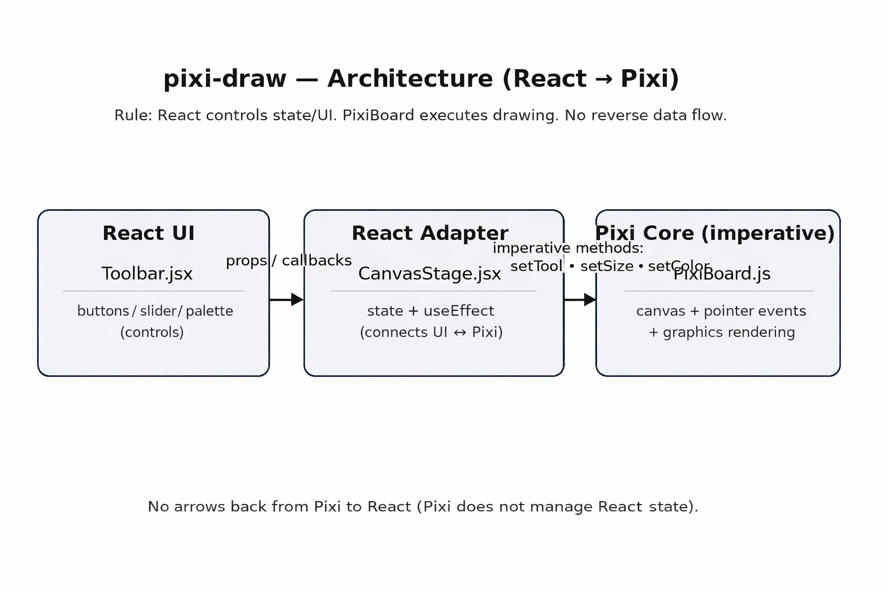
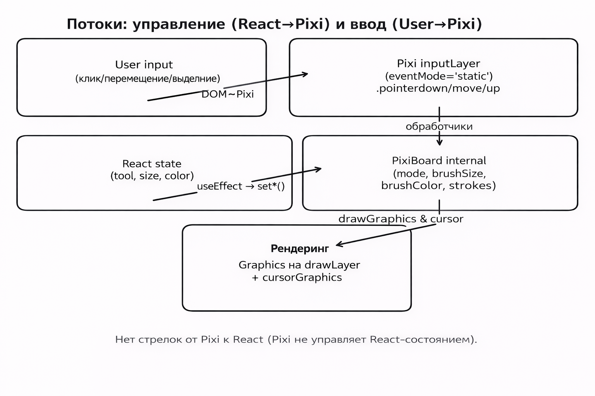

# pixi-draw — документация-памятка (React ↔ Pixi)

Этот документ — “память для будущей меня”: что где лежит, как устроено, почему именно так, и как это масштабировать.

---

## 1) Большая идея: React управляет, Pixi рисует

### Почему не рисуем из React?

React — декларативный. Он хорош для UI, состояния, форм, кнопок, но **не для рисования по каждому `pointermove`**:
- React-rerender на каждое движение мыши = лаги.
- Canvas/WebGL хотят императивный, быстрый рендер без диффа виртуального DOM.
- Логика “держим мышь зажатой и рисуем линию из точек” — это **движковая** логика.

Поэтому:
- **React хранит “настройки инструмента”** (tool/size/color)
- **PixiBoard хранит “процесс рисования”** (pointer state, текущий штрих, Graphics)

---

## 2) Схема архитектуры

### Визуально (картинка)



### ASCII-схема

```
              (props/callbacks)                 (methods)
[Toolbar.jsx] ------------------> [CanvasStage.jsx] ------------------> [PixiBoard.js]
   UI only                           adapter/state                      pixi core
  (тупой)                          useEffect + refs                  canvas + events + Graphics
```

**Важно:** поток ввода (мышь/тач) идёт **не через React**, а напрямую в Pixi (через `eventMode` и обработчики `pointer*`).

---

## 3) Что делает каждый файл

### `src/app/App.jsx`
Самый простой корневой компонент:
- рендерит `CanvasStage`

Здесь **нет логики** Pixi.

---

### `src/ui/CanvasStage.jsx` — адаптер (React ↔ Pixi)

Роли:
- хранит React-state:
  - `tool`: `'draw' | 'erase'`
  - `size`: число
  - `brushColor`: число вида `0xRRGGBB`
- хранит refs:
  - `hostRef` — DOM-контейнер для canvas
  - `boardRef` — экземпляр `PixiBoard`
- монтирует/размонтирует PixiBoard (жизненный цикл)
- “прокидывает” изменения state в PixiBoard через методы

Ключевые места:
- `useEffect(() => mount/destroy, [])`
- `useEffect(() => setTool(tool), [tool])`
- `useEffect(() => setToolSize(size), [size])`
- `useEffect(() => setBrushColor(brushColor), [brushColor])`

---

### `src/ui/Toolbar.jsx` — “тупой” UI

Роли:
- показывает кнопки, слайдер, палитру
- **не знает про Pixi**
- не хранит state про рисование, только принимает:
  - `tool, size, brushColor`
  - callbacks `onSelectTool`, `onSizeChange`, `onBrushColorChange`, `onClear`

Плюс:
- палитра сделана как числа `0xRRGGBB`
- слайдер оформлен классом `paint-range` (стили в `index.css`)

---

### `src/pixi/PixiBoard.js` — ядро Pixi (не React)

Это **класс**, который:
- создает `Application` (Pixi v8) и `canvas`
- вешает `ResizeObserver` и подгоняет `renderer.resize(...)`
- создает слои:
  - `drawLayer` — куда складываются нарисованные штрихи
  - `inputLayer` — прозрачный слой для pointer-событий
  - `cursorGraphics` — Graphics-индикатор курсора
- обрабатывает:
  - `pointerdown` → старт штриха
  - `pointermove` → добавление точек + перерисовка текущего штриха + курсор
  - `pointerup` → завершение штриха
- имеет публичные методы, которые дергает React:
  - `mount(hostElement)`
  - `destroy()`
  - `clear()`
  - `setTool(tool)` / `setMode(mode)`
  - `setToolSize(size)`
  - `setBrushColor(color)`

---

### `src/main.jsx`
Точка входа React:
- рендерит `<App />`

---

### `src/index.css`
Глобальные стили:
- базовый background/body
- стили кастомного range-slider `.paint-range`

---

## 4) Поток данных: Toolbar → CanvasStage → PixiBoard

### Схема (картинка)



### Поток управления (React → Pixi)

1) Пользователь кликает кнопку “Pen/Eraser/Clear” или двигает слайдер / выбирает цвет  
2) `Toolbar` вызывает callback  
3) `CanvasStage` меняет state (`setTool / setSize / setBrushColor`)  
4) `useEffect` ловит изменение state и вызывает метод PixiBoard:
   - `boardRef.current.setTool(tool)`
   - `boardRef.current.setToolSize(size)`
   - `boardRef.current.setBrushColor(color)`
   - `boardRef.current.clear()` (не через state, а напрямую)

**Почему Clear напрямую?**  
Это “команда”, а не “состояние”. Нам не нужно хранить “clear=true” в React — просто вызвали метод и всё.

---

## 5) Как работает ввод (pointer events) в Pixi v8

### 5.1. Где живут события
В `PixiBoard.mount()`:
- создается `inputLayer = new Container()`
- включаем события:
  - `inputLayer.eventMode = 'static'`
  - `inputLayer.hitArea = this.app.renderer.screen`
- подписки:
  - `pointerdown`
  - `pointermove`
  - `pointerup`
  - `pointerupoutside`

**Почему нужен `hitArea`?**  
Чтобы клики/движение ловились по всей области канваса, даже если там “ничего не нарисовано”.

---

## 6) Как работает рисование штрихов

### Модель данных
- `currentStroke`: массив точек `{x,y,t}` для текущего штриха (или `null`)
- `strokes`: список всех штрихов (массив массивов) — сейчас скорее для отладки/понятности
- `activeStrokeGrafics`: `Graphics`, который перерисовывается на каждом `pointermove`

### Алгоритм
**pointerdown**
- включаем `isPointerDown = true`
- вычисляем `local` координаты
- создаём `activeStrokeGrafics = new Graphics()` и добавляем в `drawLayer`
- рисуем “первую точку” как круг (чтобы клик без движения тоже дал след)
- создаём `currentStroke = [{x,y,t}]` и кладём в `strokes`

**pointermove**
- обновляем `lastCursorPos` и рисуем курсор-индикатор
- если мышь нажата — добавляем точку в `currentStroke`
- очищаем `activeStrokeGrafics.clear()`
- настраиваем стиль линии (`setStrokeStyle`)
- строим линию по всем точкам `moveTo → lineTo → stroke()`

**pointerup**
- `isPointerDown = false`
- сбрасываем `activeStrokeGrafics` и `currentStroke`

---

## 7) Как работает Eraser (частичное стирание)

В текущей реализации “ластик” — это **рисование цветом доски** (белым):
- `boardColor = 0xFFFFFF`
- при `mode === 'erase'` выбирается:
  - цвет `boardColor`
  - размер `eraserSize`

Это “частичное стирание”: мы просто перекрываем старые линии белой линией.

---

## 8) Cursor-indicator: почему он обновляется без движения мыши

Задача: если я поменяла tool/size/color, курсор должен сменить вид **сразу**, даже если мышь не двигается.

Решение в `PixiBoard`:
- при любом `pointermove` сохраняем `lastCursorPos`
- метод `_renderCursor(x,y)` рисует индикатор:
  - Pen → кольцо (circle + stroke)
  - Eraser → белый квадрат + чёрная обводка
- при смене `tool/size/color` (через методы `setToolSize/setBrushColor/setMode`) вызывается:
  - `_refreshCursorIfPossible()` → перерисует курсор на `lastCursorPos`

---

## 9) Типовые ошибки новичков (и как мы их избегаем)

1) **Пытаться хранить все точки штриха в React-state**  
   → приводит к ререндеру на каждое движение, лагам и “дерганью”.

2) **Создавать Pixi Application в React render-фазе**  
   → нельзя. Делать только в `useEffect` (side-effect).

3) **Забывать destroy**  
   → утечки памяти, остаются canvas и обработчики.

4) **Не ставить `eventMode` / `hitArea`**  
   → события “не приходят” или приходят только по нарисованным объектам.

5) **Ресайз канваса только через CSS**  
   → картинка растянется, координаты будут “плыть”.
   Мы делаем `renderer.resize(width, height)` через `ResizeObserver`.

---

## 10) Как масштабировать проект дальше (не ломая архитектуру)

Принцип: **расширяем PixiBoard как “движок”, React остаётся UI + state.**

Идеи шагов:
- Добавить инструменты:
  - Line / Rectangle / Circle
  - Fill (заливка)
  - Picker (пипетка)
- Добавить слои:
  - backgroundLayer
  - strokesLayer
  - uiOverlayLayer
- Оптимизация:
  - хранить штрихи как геометрию/команды и перерисовывать по требованию
  - batch / кэширование для большого количества линий
- Добавить Undo/Redo:
  - стек команд: `ADD_STROKE`, `CLEAR`, ...
  - важно: не ререндерить React на каждую точку, только на “команду”
- Сохранение:
  - `app.renderer.extract.canvas(...)` или `extract.image(...)` (когда будет нужно)

---

## 11) Troubleshooting (быстрые чек-листы)

### “Не рисует / не приходят события”
- `inputLayer.eventMode = 'static'` есть?
- `inputLayer.hitArea = app.renderer.screen` обновляется после resize?
- контейнер `hostRef` реально имеет размер (не 0x0)?
- canvas смонтирован в DOM?

### “Курсор не обновляется после смены размера”
- вызывается ли `setToolSize(size)` из React?
- сохраняется ли `lastCursorPos` в `pointermove`?

### “Растягивает/размывает канвас”
- должен быть `renderer.resize(width,height)` (не только CSS)

---

## 12) Sources / References

PixiJS v8:
- Application (async `init()`): https://pixijs.download/dev/docs/app.Application.html ; гайд: https://pixijs.com/8.x/guides/components/application
- Events / Interaction (eventMode, pointer events): https://pixijs.com/8.x/guides/components/events ; overview: https://pixijs.download/v8.14.2/docs/events.html
- Graphics (API reference): https://pixijs.download/dev/docs/scene.Graphics.html ; (версия) https://pixijs.download/v8.0.0/docs/scene.Graphics.html
- Graphics guide (GraphicsContext): https://pixijs.com/8.x/guides/components/scene-objects/graphics
- v8 Migration Guide: https://pixijs.com/8.x/guides/migrations/v8

React:
- useEffect: https://react.dev/reference/react/useEffect
- useRef: https://react.dev/reference/react/useRef
